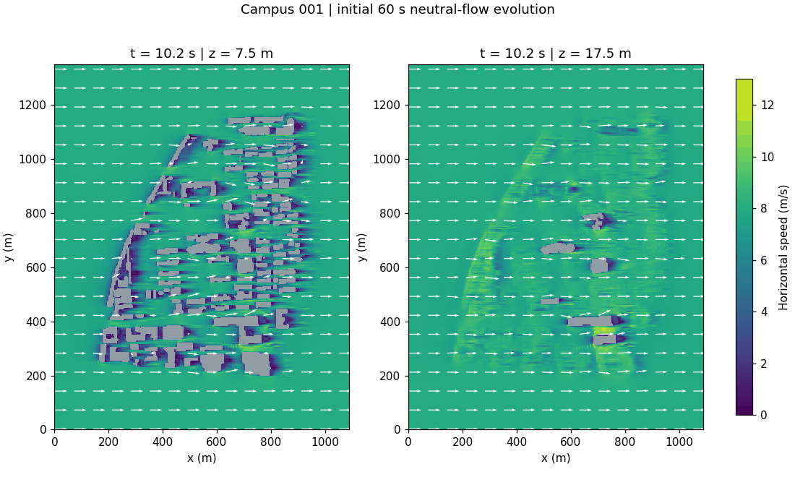
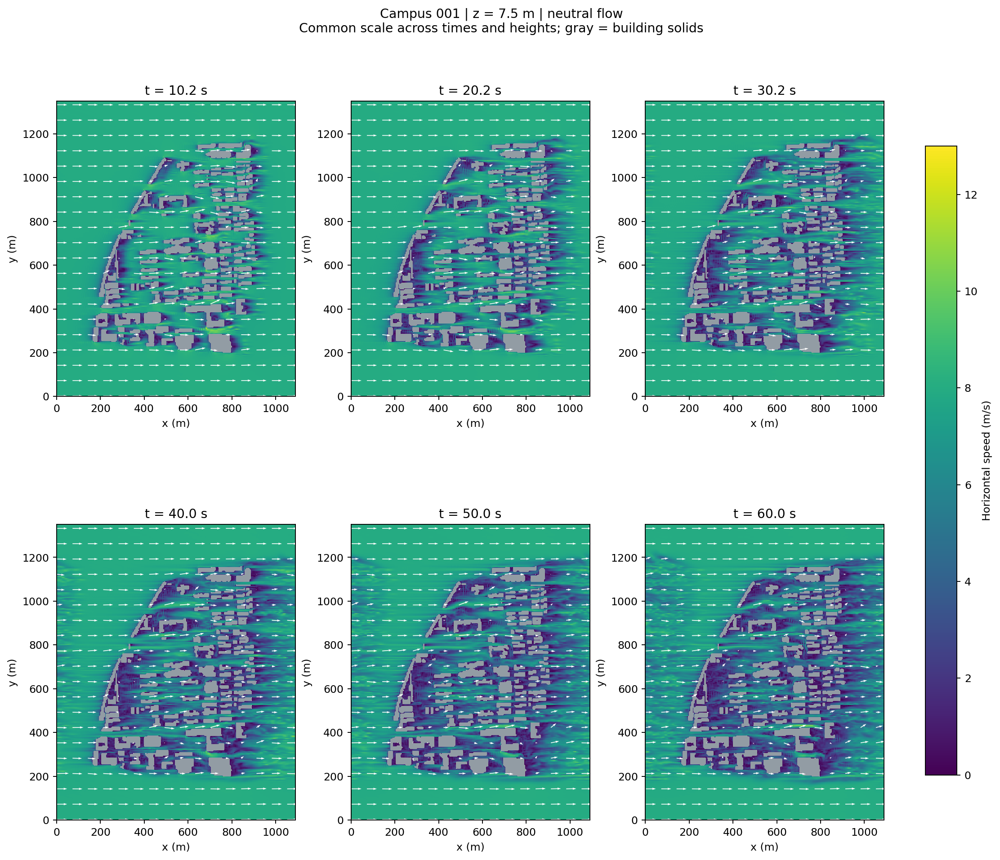
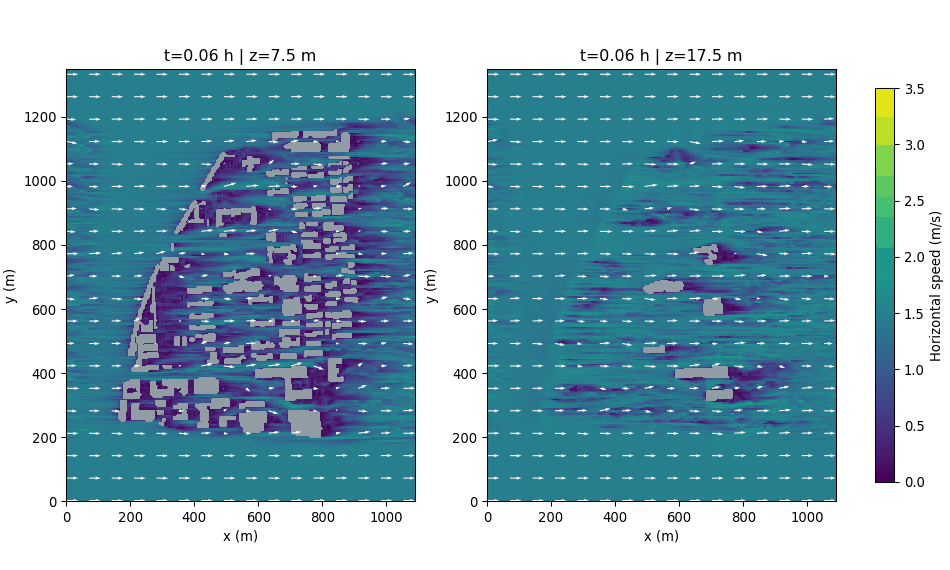
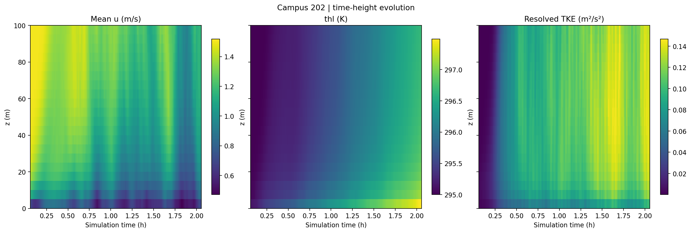
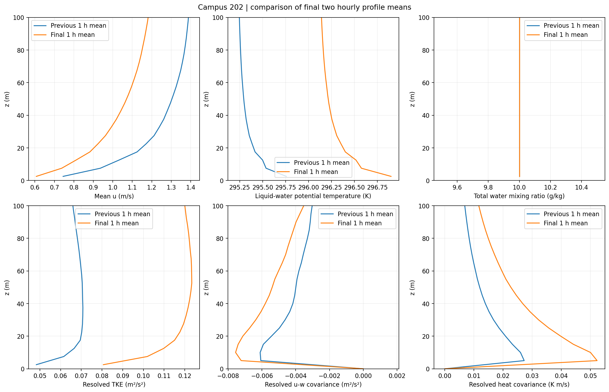
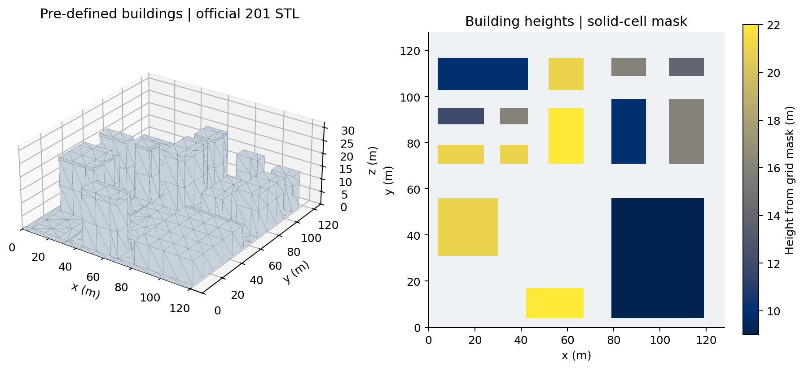
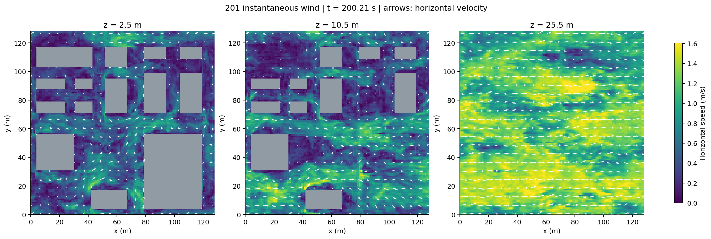

# USTC East Campus LES

使用 **[uDALES](https://github.com/uDALES/u-dales)** 建立中国科学技术大学东校区周边建筑模型，模拟地转风驱动的校园风场。目前已完成官方 **201** 示例复现、校园 IBM 前处理、关闭热力作用的中性风场试算，以及包含表面能量平衡的校园 **202** 长时段续算。

## 校园中性风场：campus_neutral



动画展示 **10.2、20.2、30.2、40、50、60 秒**的水平风场；左侧高度 **7.5 m**，右侧 **17.5 m**。颜色为水平风速，箭头为水平速度，灰色为该高度的建筑实体。所有时刻与高度使用统一 **0–13 m/s** 色标，可观察建筑背风侧低速区向下游发展。

四个 MPI 分片按实际坐标拼接，交错网格的 u/v 插值到单元中心，实体内部数据被遮罩。当前属于初始过渡阶段，**不代表统计稳态，也尚未通过独立参考输出的数值验证**。

| 配置 | 当前试算 |
| --- | --- |
| 计算域 | 1090 × 1350 × 400 m |
| 网格 | 218 × 270 × 80，均匀 5 m |
| MPI 分解 | 2 × 2，共 4 个进程 |
| 初始水平风 / 地转风 | (8, 0) m/s |
| 热力 | 温度输运、浮力、湿度和表面能量平衡均关闭 |
| 壁面 / SGS | 中性壁面 iwallmom=3 / Vreman |
| 水平边界 | 周期边界；区域周期重复 |
| 输出 | 每约 10 秒输出 u、v、w；本次积分到 60 秒 |

### 不同时刻的风场



更多切片：[17.5 m](docs/assets/campus_neutral/campus_wind_z17p5.png)、[57.5 m](docs/assets/campus_neutral/campus_wind_z57p5.png)。近地面绕流与尾流较明显；57.5 m 位于当前最高建筑上方。

## 校园 202 热力耦合实验



该实验由 200 s 启动段继续积分至约 **7400 s** 物理时间。随着表面升温，近地层由规则建筑尾流逐渐发展为覆盖计算域的热对流湍流。





最后两个一小时窗口的 7.5、17.5 和 57.5 m 平均风速仍分别变化约 **−21.2%、−21.5% 和 −17.3%**；表面面积加权平均温度最终约为 **308.16 K**。因此当前结果已经形成热对流湍流，但还不能视为统计稳态。完整 PNG、PDF、GIF 和数值摘要见[结果文件索引](docs/results.md)。

## 几何与数据来源

研究范围为 **黄山路—太湖路—金寨路—宿松路围合区域**，道路矢量形成的不规则闭合区域面积约 **0.625 km²**。计算网格使用规则长方体：现有地面已延拓至 1090 × 1350 m 矩形，研究区域外作为无建筑平地，尚未补齐周边建筑。

已提取 **146 条 OSM 建筑记录**，重叠实体通过布尔并集合并，保留高度台阶；建筑和含地面的 STL 通过官方 UDGeom 几何检查。最高几何高度约 **52.8 m**。

**9 条高度由楼层数 × 3.3 m 估算，137 条采用 12 m 情景值**。布局完整性、建筑高度和底图配准仍待核验，模型不能作为实测校园几何。地面延拓不等于补齐周边建筑；5 m 网格尚未经过收敛检验。

数据来源为 © OpenStreetMap contributors，遵循 [ODbL](https://www.openstreetmap.org/copyright)。本项目未使用 Google Maps 数据提取，相关布局核对尚待完成。

## 官方 201 示例

使用固定版本自带的建筑、IBM 和辐射输入运行官方 201，以检查编译环境和输出流程。网格 128³、MPI 分解 2×2，开启温湿度、浮力和表面能量平衡；最后风场输出时刻约 **200.21 秒**。





其他结果：[温湿度与垂直速度](docs/assets/case201/201_scalars.png)、[统计剖面](docs/assets/case201/201_profiles.png)、[表面温度与能量通量](docs/assets/case201/201_surface_energy.png)。这些图来自本次运行，不是独立的官方参考答案；短示例运行成功不等于物理或统计验证通过。

## 重建与运行入口

源码固定提交为 `42e40b6e1efd5529cfba8edd35005123e0ff70e4`，记录在 configs/udales_source.json。源码、Python 依赖与原始运行数据位于被 Git 忽略的 vendor/、outputs/；仓库保留配置、几何、脚本以及全部导出的结果图、PDF、GIF 和摘要。集群账号、主机、模块、分区及路径在公共模板中均使用占位符。

| 操作 | 说明 |
| --- | --- |
| 几何与原始输入准备 | [uDALES 工作流程](docs/udales_workflow.md) |
| 编译依赖及求解器 | [依赖构建说明](docs/hpc_build.md)、[通用安装说明](docs/hpc_udales.md) |
| 官方 201 运行 | [201 操作说明](docs/hpc_case201.md) |
| 校园中性风场准备、IBM 与试算 | [校园运行说明](docs/campus_neutral_run.md) |
| 校园 202 热力耦合实验（已完成约 7400 s 物理时间试算） | [202 设置与运行](docs/campus202_run.md) |
| 全部结果图、PDF、动画与摘要 | [结果文件索引](docs/results.md) |
| 物理方法与验证路线 | [方法说明](docs/methodology.md) |
| 几何核验 | [几何说明](docs/geometry.md) |

本地 Python 使用已有 turbpy 环境。在项目根目录执行：

```bash
conda activate turbpy
python scripts/preflight.py
# 仅在需要重建几何时执行；需要原始 OSM 数据和项目依赖
python scripts/prepare_udales_geometry.py
python scripts/prepare_udales_inputs.py
```

以上生成的是原始前处理草案。校园风场使用单独的 namoptions.neutral.001 模板，避免覆盖原始草案；不要将 runtime=0 的草案当作可直接模拟的输入。独立 staging 和上传包通过 `python scripts/prepare_campus_neutral.py` 创建，已有目录会被保留并阻止覆盖。

### 重建结果图片

将官方 201 运行数据放在 `outputs/validation/run/201/`，校园数据放在 `outputs/campus_neutral_setup/001/`，然后执行：

```bash
python scripts/visualize_case201.py
python scripts/visualize_campus_wind.py
python scripts/visualize_campus202.py
python scripts/visualize_campus202_long.py
```

图像输出到 `outputs/validation/figures/` 下对应算例目录，同时生成 PNG/PDF 与摘要，校园脚本额外生成 GIF。长时段 202 脚本默认读取 `outputs/validation/run/202/202_run7200/`，比较最后两个一小时统计窗口。全部导出结果的 Git 发布副本位于 `docs/assets/results/`；再次绘图后需要重新复制，才会更新发布图片。原始 `cases/001/input_status.json` 记录的是早期本地准备状态，不代表后来远程前处理和试算的最新状态。

## 下一步

核验建筑布局和高度，检查 IBM missing-flux 面积对应的壁面映射；依据短试算的时间、内存和流场演变延长预热与采样。当前主风向域穿越时间约 1090/8 ≈ **136 秒**，60 秒还不足一次穿越，不能据此判断稳态。之后评估周期边界、周边建筑与网格分辨率，再配置稳定分层和地面冷却，开展独立参考对比与物理验证。
